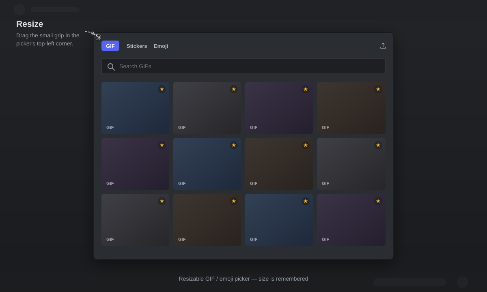

# Vencord Expression Picker Resize

**A larger, resizable and persistent GIF / emoji picker for Vencord on Windows.**
One-click installer, no Vencord build required.

## Features

- Much larger GIF / sticker / emoji picker by default.
- **Width + height** resizing with a small, discreet grip inside the
  top-left corner.
- Size remembered between openings and restarts
  (width is stored by Discord, height in `size.json`).
- No more blue flash: GIF tiles stay dark until their first frame is
  ready, then fade in.
- **Import local files** with the upload button in the top-right corner of
  the GIF page. GIF, PNG, JPEG, WebP, AVIF, APNG, BMP, MP4, WebM, MOV and
  MKV are accepted and converted to GIF automatically.
- Imported GIFs appear in a dedicated **Importés** category in the GIF
  picker, with the same masonry layout as native Favorites. Click one to
  attach it to the message box.
- Survives Discord updates.
- Survives Vencord updates thanks to a small watcher that re-applies the
  loader when `preload.js` is replaced.

## Why not a Vencord plugin?

The official Vencord installer does not load external plugins. Vencord
`userplugins` are only supported when Vencord is built from source, which
requires Node.js, pnpm, git and a full build.

This project uses a simpler approach: a small renderer script injected
through `preload.js`, plus a watcher that re-applies the hook after a
Vencord update. No Vencord build is required.

## Installation

1. Download the latest release:
   <https://github.com/quentingimenez/vencord-expression-picker-resize/releases/latest>
2. Extract the ZIP.
3. Close Discord (recommended).
4. Double-click **`install.cmd`**.
5. Restart Discord.

> Windows 10/11, Discord desktop and Vencord installed with the official
> installer. Vesktop and BetterDiscord are not supported.

## Usage

Open the GIF picker from the message bar. A small diagonal grip is
available in the **top-left corner** of the panel:

- drag it up/left to enlarge the picker;
- drag it down/right to shrink it;
- the size is remembered automatically.

Discord's native width-only handle on the left edge is hidden; the custom
grip handles both dimensions.

### Importing local GIFs

1. Open the GIF picker.
2. Click the **upload icon** in the top-right corner of the GIF page.
3. Select one or more files. Accepted formats: GIF, PNG, JPEG, WebP, AVIF,
   APNG, BMP, MP4, WebM, MOV and MKV.
4. Images and videos are converted to GIF automatically (max 480 px,
   6 seconds, 10 fps, 8 MB output).
5. Open the **Importés** category in the GIF picker. The first tile has the
   same function as the top-right upload button, so you can import more
   files from there. Imported GIFs use the same masonry sizing as native
   Favorites. Click one to attach it to the message box; the picker closes
   automatically. Press Enter to send it.

Imported GIFs are stored **locally** in this Discord installation
(IndexedDB). They are not synced to other devices, and they are sent as
normal file attachments rather than provider GIF links. They stay visible
in **Importés** even if you also save them in Discord's native favorites,
so use the × button on a thumbnail to delete the local import in one click.

Limits: input files up to 100 MB; converted GIFs up to 8 MB.

## Uninstall

Double-click **`uninstall.cmd`**, then restart Discord.

The installer keeps a backup of `preload.js` at
`preload.js.bak-picker-resize` and restores it during uninstallation.

## Updates

- **Discord updates**: Vencord automatically re-patches the new `app.asar`;
  no action is required.
- **Vencord updates**: the watcher monitors
  `%APPDATA%\Vencord\dist\preload.js` and re-applies the loader
  automatically. If the grip ever disappears after an update, run
  `install.cmd` again and restart Discord.

## How it works

The installer:

1. copies `picker-resize.js` and `watcher.ps1` to
   `%LOCALAPPDATA%\VencordPickerResize\`;
2. appends a loader to `%APPDATA%\Vencord\dist\preload.js`;
3. creates `VencordPickerResize.vbs` in the Startup folder;
4. starts the watcher, which keeps the loader in place after updates.

The script and saved height live outside Vencord, so reinstalling Vencord
does not remove them. Imported GIFs are stored in Discord's IndexedDB
(local to this installation). Conversion runs entirely in the renderer
using the bundled `gifenc` encoder; no network access, no telemetry.

## Troubleshooting

- **"Vencord was not found"**: Vencord is not installed at the standard
  path, or you are using Vesktop. This project targets the official
  Vencord installer.
- **Nothing happens after restarting**: run `install.cmd` again, then
  restart Discord. Check that
  `%APPDATA%\Vencord\dist\preload.js` contains
  `VC_PICKER_RESIZE_LOADER_START`.
- **The grip disappeared after an update**: the watcher was probably not
  running. Run `install.cmd` again.
- **Antivirus / PowerShell**: the scripts are readable and only copy local
  files and modify `preload.js`. `install.cmd` starts PowerShell with
  `-ExecutionPolicy Bypass` to allow unsigned scripts.

## Disclaimer

Unofficial project, not affiliated with Discord or Vencord. Modifying
`preload.js` can break after an incompatible update. Use at your own risk.

## License

MIT — see [LICENSE](LICENSE).

The bundled GIF encoder is [gifenc](https://github.com/mattdesl/gifenc),
also MIT — see [THIRD_PARTY_NOTICES.md](THIRD_PARTY_NOTICES.md).
